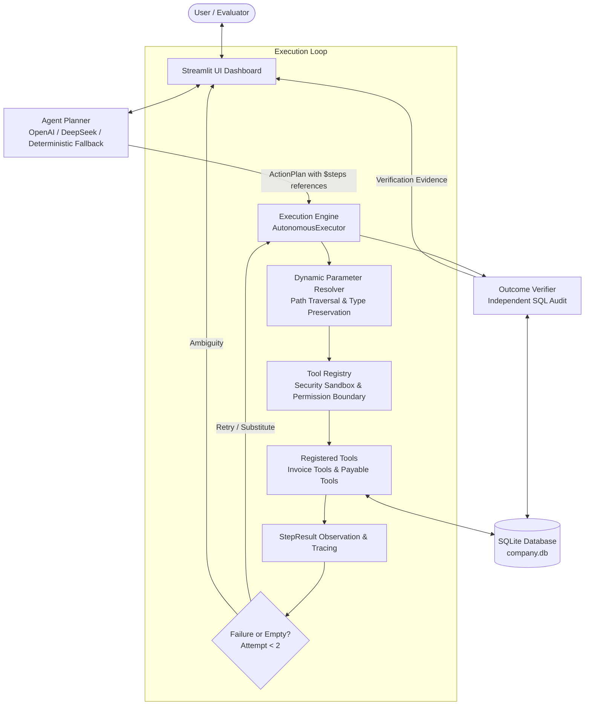

# Autonomous AI Task Worker

[](https://www.python.org/downloads/)
[](https://streamlit.io/)
[](https://www.sqlite.org/)
[](https://docs.pydantic.dev/)
[](https://pytest.org/)

**CentrAlign AI Engineering Challenge Submission: Autonomous AI Task Worker**

---

## Overview

Modern enterprises face significant productivity bottlenecks in repetitive administrative back-office workflows—such as invoice processing, ledger reconciliation, and vendor record management. While Large Language Models (LLMs) excel at language interpretation, unconstrained LLM agents frequently fail in production due to hallucinations, unpredictable tool execution, silent data corruption, and catastrophic financial side effects.

The **Autonomous AI Task Worker** bridges the gap between probabilistic AI reasoning and deterministic enterprise execution. It acts as a reliable autonomous digital employee designed around five foundational pillars:

1. **Structured Goal Planning**: Decomposes freeform natural language requests into structured, validated action plans.
2. **Sandboxed Tool Execution & Dynamic Data Piping**: Executes only vetted, schema-validated tools using dynamic reference resolution (`$steps.<step_id>.result.<field>`) rather than hardcoded pipeline bindings.
3. **Bounded Autonomy & Human Approval**: Pauses execution before irreversible state changes (e.g., entering accounts payable financial commitments), requiring explicit human-in-the-loop sign-off.
4. **Independent Outcome Verification**: Cross-checks persistent database state against source truth documents before declaring success, eliminating false positives.
5. **Dynamic Failure Replanning & Clarification**: Inspects runtime failures, adapts search queries or tool choices within strict bounds (`MAX_REPLANNING_ATTEMPTS = 2`), and solicits user clarification when ambiguities arise.

---

## Demo Workflow

Consider the flagship enterprise task:

> **"Find the latest invoice from Acme Technologies, extract amount and due date, enter it into payable system, and confirm completion."**

The autonomous worker executes this request through a 7-stage lifecycle:

```
[1. Goal Understanding] ──► [2. Planning] ──► [3. Tool Execution] ──► [4. Observation]
                                                                             │
[7. Final Response] ◄── [6. Independent Verification] ◄── [5. Approval Step] ◄─┘
```

1. **Goal Understanding**:
   The planner receives the natural-language goal and extracts target entities (`Acme Technologies`), desired fields (`amount`, `due date`), and action intent (`payable entry`, `confirmation`).
2. **Planning**:
   Generates an action plan containing:
   - `Step 1`: `search_invoices(vendor_name="Acme Technologies")`
   - `Step 2`: `read_invoice(filename="$steps.search_invoices.result.matches[0].filename")`
   - `Step 3`: `extract_invoice_data(raw_content="$steps.read_invoice.result.content", file_type="$steps.read_invoice.result.file_type")`
   - `Step 4`: `create_payable_record(...)` with dynamic references to extracted fields (`consequential: true`).
3. **Tool Execution**:
   The execution engine resolves dynamic parameter references against cached step outputs and runs each tool in an isolated sandbox.
4. **Observation**:
   Captures structured JSON results, execution latencies, and status metadata into persistent execution traces.
5. **Approval Step (Human-in-the-Loop Safeguard)**:
   Before executing `create_payable_record`, the engine detects `consequential: true`, halts the task in `APPROVAL_REQUIRED`, and presents the extracted invoice summary ($2,750.50 due 2024-12-15) for user review in the UI.
6. **Independent Verification**:
   Upon approval and insertion, the `OutcomeVerifier` independently queries SQLite directly (bypassing LLM interpretation) and compares 4 financial attributes against the source invoice document:
   - Exact invoice number match (`INV-2024-002`)
   - Vendor name normalization match (`ACME TECHNOLOGIES INC.`)
   - Float numerical amount equality within 0.005 tolerance (`$2,750.50`)
   - Due date string equality (`2024-12-15`)
7. **Final Response**:
   The system transitions to `SUCCESSFUL`, outputting verified payable database IDs, execution traces, and audit logs.

---

## Architecture



### Component Hierarchy
- **Streamlit UI**: Presentation and human approval surface with real-time trace inspection and interactive clarification inputs.
- **Agent Planner**: Generates structured `ActionPlan` models with dynamic reference bindings. Operates via LLM API or deterministic fallback.
- **Execution Engine**: Orchestrates execution state machines, recoverable retry policies, human-in-the-loop pauses, and replanning loops.
- **Dynamic Parameter Resolver**: Generic engine resolving `$steps.<tool>.result.<path>` tokens into primitive Python types (`float`, `dict`, `list`).
- **Tool Registry**: Sandbox perimeter preventing arbitrary code execution. Validates inputs against Pydantic schemas.
- **Tools**: Single-responsibility workers (`search_invoices`, `read_invoice`, `extract_invoice_data`, `create_payable_record`, `get_payable_record`, `list_payables`).
- **SQLite Database**: Persistent store for payables, task states, execution traces, and step results.
- **Outcome Verifier**: Out-of-band audit layer comparing persistent SQL state with ground truth invoice documents.

---

## Key Engineering Decisions

### 1. Bounded Autonomy Over Unrestricted Execution
Autonomous agents given unbounded loops can spin indefinitely on failing tools, incur excessive API costs, or drift into unintended states. This implementation bounds autonomy to a strict cycle with `MAX_REPLANNING_ATTEMPTS = 2` and max tool retries (`MAX_RETRIES = 3`). Tasks that cannot be resolved automatically halt cleanly in `CLARIFICATION_REQUIRED` or `FAILED`.

### 2. Explicit Tool Registry (Sandbox Perimeter)
Allowing an LLM to generate raw code, bash scripts, or shell commands introduces severe vulnerabilities (e.g., prompt injection leading to remote code execution). The `ToolRegistry` enforces an allowlist model: only pre-registered tools with strict Pydantic schemas can execute. Unauthorized tool names raise `PermissionDeniedError`.

### 3. Human Approval Before State-Changing Actions
Financial commitments (creating payable records) cannot rely purely on probabilistic LLM inferences. Tools marked `consequential: True` trigger a state machine transition to `APPROVAL_REQUIRED`. The agent pauses, preserves execution state, and awaits explicit human confirmation via the UI.

### 4. Independent Verification
Self-reported tool outputs cannot be trusted as definitive proof of task completion. The `OutcomeVerifier` runs as a distinct post-execution phase that queries the database directly and performs strict multi-attribute matching against source data. If any field diverges (amount, vendor, due date), the task fails verification.

### 5. Deterministic Safeguards Around LLM Behavior
LLMs provide flexible natural language translation and query formulation, but should not control financial math, SQL transactions, or system state transitions. All parameter validation, type coercion, retry math, and database integrity rules are implemented deterministically in Python.

---

## Reliability Features

- **Exponential Backoff & Retries**: Distinguishes transient I/O exceptions (`RecoverableToolError`) from non-recoverable schema faults, retrying up to 3 times before triggering replanning.
- **Dynamic Replanning on Failure**: When a tool fails or yields zero matches, the failure context is analyzed by the replanner to retry with relaxed parameters or substitute tools without starting over.
- **Interactive Clarification**: Ambiguous vendor entities or incomplete records halt with `CLARIFICATION_REQUIRED`, presenting a dedicated UI prompt for user guidance and resuming the same task instance.
- **Duplicate Prevention & Idempotency**: Database-level unique constraints `UNIQUE(vendor_name, invoice_number)` prevent duplicate ledger entries on retries or re-executions.
- **Granular Execution Traces**: Every tool invocation records step number, tool name, resolved parameters, outputs, errors, latencies, and timestamps directly to SQLite for post-mortem auditing.

---

## Security

- **Zero Arbitrary Code Execution**: No `eval()`, `exec()`, or unsanitized shell invocations.
- **Pydantic Schema Validation**: Every input argument and output payload is strictly validated at runtime against strongly-typed Pydantic schemas.
- **Path Traversal Sandboxing**: Invoice file access is strictly constrained to the authorized `data/invoices/` directory; attempts to traverse outside (`../../`) are blocked.
- **Credential Isolation**: LLM API keys and configuration parameters are loaded via environment variables (`.env`) and never logged in execution traces.

---

## Testing & Verification

The suite includes **24 automated tests** covering unit, integration, and end-to-end failure scenarios.

### Test Matrix

| Test Module | Tests | Scenarios Covered |
| :--- | :---: | :--- |
| `tests/test_database.py` | 3 | CRUD operations, duplicate payable rejection, task & trace persistence |
| `tests/test_tools.py` | 8 | Invoice discovery, multi-format reading (JSON/TXT), malformed JSON handling, ambiguity detection, tool registry sandboxing |
| `tests/test_resolver.py` | 3 | Dot and bracket path traversal, primitive type preservation, novel non-invoice tool-to-tool workflows |
| `tests/test_replanning.py` | 4 | Vendor search relaxation recovery, `MAX_REPLANNING_ATTEMPTS` enforcement, interactive clarification resumption, demo environment reset |
| `tests/test_scenarios.py` | 6 | E2E core Acme workflow with HITL approval, duplicate execution blocking, missing file handling, malformed invoice recovery, transient failure backoff, independent verifier tampering detection |

Run all tests via:
```bash
pytest -v
```

---

## Limitations

- **Simulated Back-Office Environment**: Operates against local file stores and an embedded SQLite database rather than external ERP systems (SAP, Oracle, NetSuite).
- **Tool Domain Scope**: Toolset is optimized for document extraction and payable records; expanding to general ledger or bank reconciliation requires additional tool definitions.
- **SQLite Concurrency**: SQLite file locking is suited for demonstration and single-worker setups; enterprise production requires PostgreSQL.
- **Bounded Replanning Scope**: The recovery loop supports up to 2 replanning attempts to avoid infinite loops, meaning edge cases with multiple compound errors require human intervention.

---

## Future Improvements

- **Enterprise ERP Connectors**: Native adapters for SAP S/4HANA, NetSuite SuiteTalk REST APIs, and Workday.
- **PostgreSQL & Distributed Celery/Temporal Workers**: Migrate from SQLite to an event-driven distributed task execution architecture with durable orchestration.
- **Multi-Modal Document Parsing**: Integrate vision models (LayoutLM, Gemini Vision) to parse non-standard scanned PDF and image receipts.
- **Multi-Agent Orchestration**: Separate roles into specialized planner, executor, auditor, and communication agents.

---

## 🛠️ Demo Data Reset & Evaluation Instructions

Evaluators can run and reset the demo environment repeatedly without manual cleanup.

### 1. Setup Environment
```bash
# Clone and navigate to project root
cd AI_Task_Manager

# Create and activate virtual environment
python -m venv .venv
# Windows:
.\.venv\Scripts\activate
# macOS/Linux:
source .venv/bin/activate

# Install dependencies
pip install -r requirements.txt
```

### 2. Configure API Key (Optional)
Copy `.env.example` to `.env`. If using OpenAI, DeepSeek, or any compatible endpoint:
```env
OPENAI_API_KEY=your_api_key_here
OPENAI_BASE_URL=https://api.openai.com/v1
OPENAI_MODEL=gpt-4o-mini
```
*Note: If no API key is provided, the system seamlessly operates using its deterministic planning mode.*

### 3. Run Automated Tests
```bash
pytest -v
```
*Expected: 24 passed.*

### 4. Launch Streamlit Application
```bash
streamlit run app.py
```
Open [http://localhost:8501](http://localhost:8501) in your browser.

### 5. Reset Demo Environment
1. In the Streamlit sidebar, locate **Demo Controls**.
2. Click **"Reset Demo Environment"**.
3. All tasks, traces, and payable records are purged, and sample invoices are re-initialized.

### 6. Test Core Scenarios in the UI
- **Happy Path Workflow**: Click sample prompt `1. Process Acme Invoice (Standard Workflow)`. Click **Execute Autonomous Task**. Review the generated plan, click **Approve & Continue** when prompted, and observe the successful independent verification.
- **Interactive Clarification**: Click sample prompt `3. Ambiguous Vendor Invoice (Clarification Flow)`. Execute the task. The agent halts with `CLARIFICATION_REQUIRED`. In the clarification box, enter `Process Acme Technologies` and click **Submit Clarification & Resume Task**. Observe the task resume and complete successfully.
- **Duplicate Prevention**: Re-run the Acme prompt without resetting. The system detects the duplicate and prevents duplicate ledger entries.
